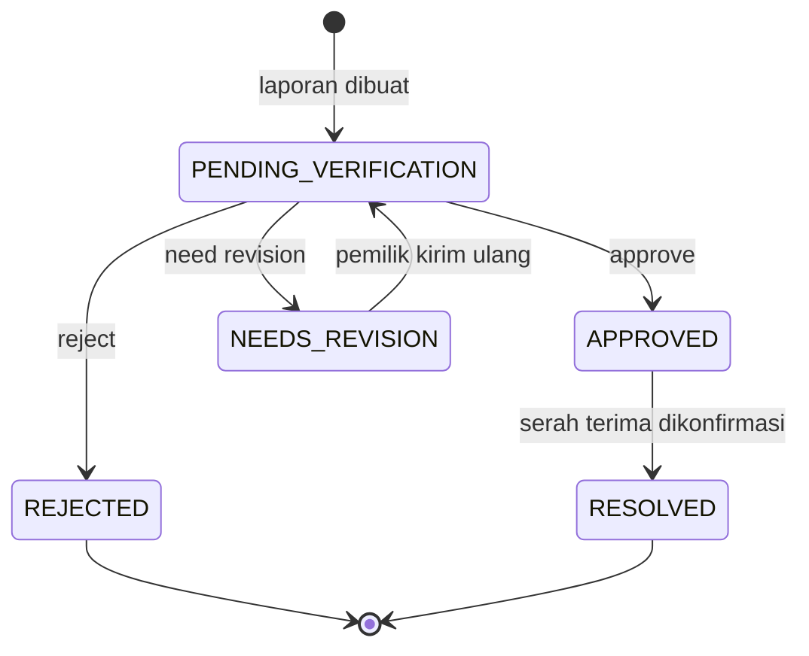
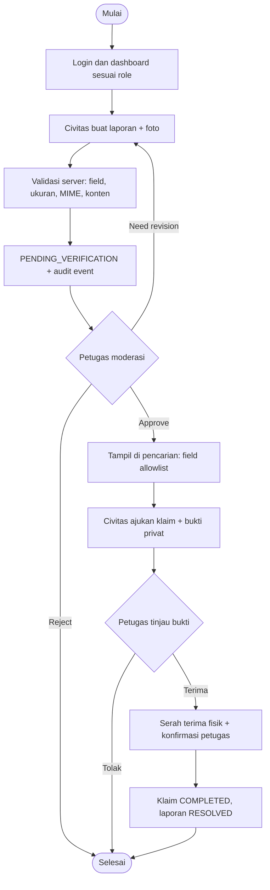
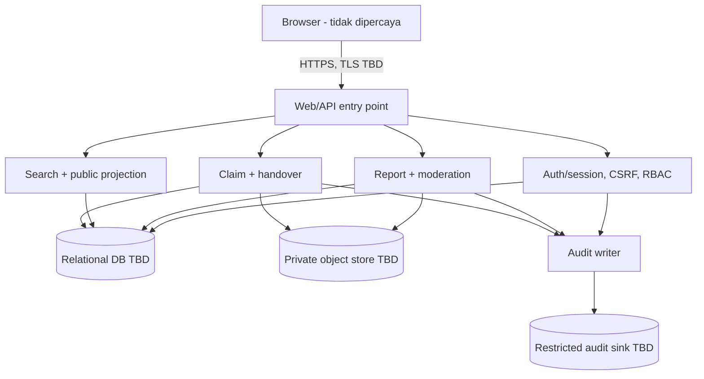
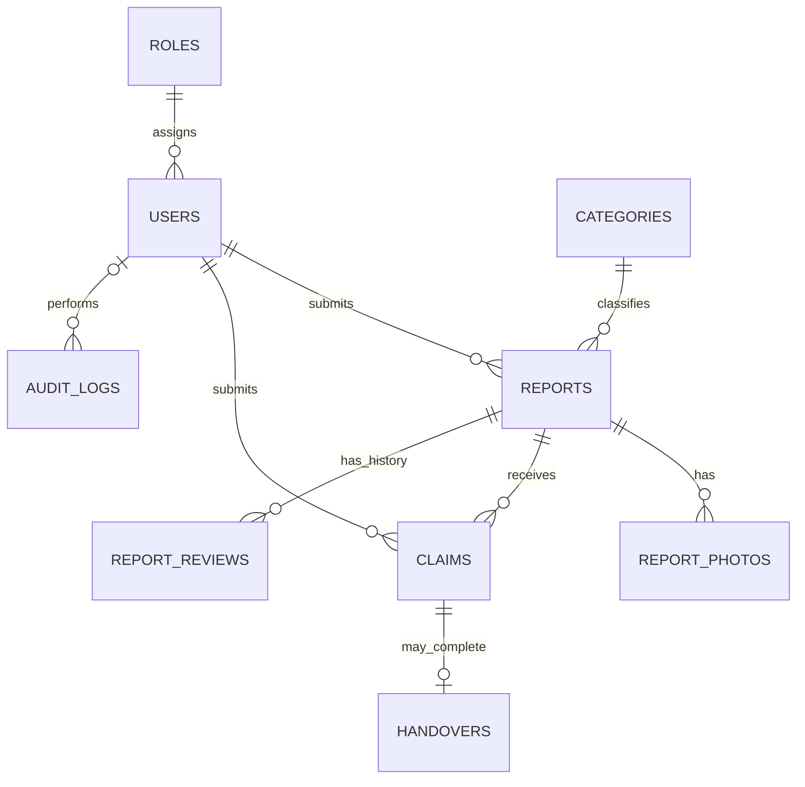
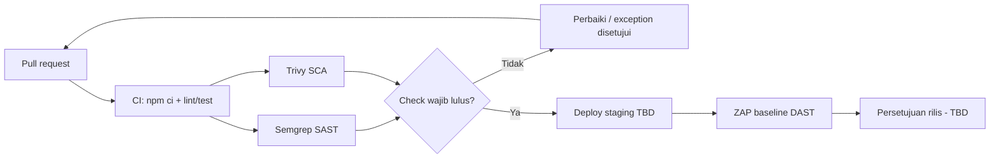

# Product Requirements Document (PRD) — Sistem Lost & Found FTE

## Informasi Dokumen

| Atribut | Nilai |
|---|---|
| Nama produk | Sistem Lost & Found FTE |
| Jenis dokumen | Product Requirements Document (PRD) |
| Versi dokumen | 1.1 (Draft) |
| Tanggal | 5 Oktober 2026 |
| Status | **Draft untuk review** — bukan bukti sistem produksi |
| Rujukan primer | PRD v1.0.0 (22 September 2026) dan dokumen desain sistem |
| Konvensi | **TBD** = keputusan belum disetujui; jangan dianggap sebagai kebijakan |

### Penulis

| Nama | NIM | Peran |
|---|---|---|
| Ardika Putra Hadian | 101032300240 | Penulis |
| Naufal Alif Abyan | 101032300032 | Penulis |

### Riwayat Revisi

| Versi | Tanggal | Penulis | Perubahan |
|---|---|---|---|
| 1.0 | 22 September 2026 | Tim penulis | PRD awal (v1.0.0) |
| 1.1 | 5 Oktober 2026 | Ardika Putra Hadian, Naufal Alif Abyan | Menambah kontrol dokumen, stakeholder dan persona, user story, persyaratan UX, dan rencana rilis |

### Persetujuan

| Peran | Nama | Tanda tangan / Tanggal |
|---|---|---|
| Product owner | TBD | |
| Perwakilan FTE / Petugas L&F | TBD | |
| IT / Security | TBD | |

---

## 1. Ringkasan Eksekutif

Sistem Lost & Found FTE adalah aplikasi web untuk mengelola barang hilang (*lost*) dan barang temuan (*found*) di lingkungan FTE. Civitas dapat melapor, mencari, dan mengklaim barang. Petugas L&F memoderasi laporan, memverifikasi klaim, dan mengonfirmasi serah terima fisik. Super Admin mengelola akun, kategori, dan audit keamanan.

**Visi produk:** mempertemukan barang hilang dengan pemilik sahnya secara cepat, terlacak, dan aman.

Dua prinsip utama produk:

1. **Privasi sebagai invarian.** Bukti klaim hanya dapat diakses petugas berwenang, dan hasil pencarian publik hanya menampilkan field yang masuk allowlist.
2. **Otorisasi di sisi server.** Browser, request, cookie, header, dan file dianggap tidak tepercaya.

## 2. Latar Belakang dan Masalah

| Masalah | Dampak |
|---|---|
| Pelaporan barang hilang/temuan belum terpusat dan tidak terlacak | Barang sulit dipertemukan dengan pemiliknya |
| Tidak ada verifikasi kepemilikan yang terstruktur | Risiko klaim palsu dan penipuan |
| Detail barang sensitif dapat terekspos | Risiko privasi dan keamanan |
| Tidak ada jejak keputusan dan serah terima | Sengketa sulit diselesaikan |

## 3. Tujuan, Non-Tujuan, dan Indikator Keberhasilan

### 3.1 Tujuan
- G-1: Civitas dapat membuat laporan *lost*/*found* lengkap dengan foto.
- G-2: Setiap laporan dimoderasi petugas sebelum tampil publik.
- G-3: Civitas dapat mencari dan memfilter laporan yang disetujui.
- G-4: Klaim diverifikasi dengan bukti privat sebelum serah terima.
- G-5: Seluruh aksi penting tercatat dalam audit log tanpa menyimpan secret.

### 3.2 Non-Tujuan (di luar lingkup versi ini)
- Deploy/promosi ke production (belum ada desain disetujui).
- Pemilihan vendor/teknologi (framework, DB, hosting, object storage, IdP).
- Kanal notifikasi (email/push) — kanal dan implementasi belum diputuskan.
- Mekanisme banding, klaim bersaing, pembatalan/reopen klaim (**TBD**, lihat D-06).

### 3.3 Indikator Keberhasilan (usulan, target perlu disetujui)

| Metrik | Definisi | Target |
|---|---|---|
| Waktu moderasi | Submit → keputusan petugas | TBD (SLA belum ditetapkan) |
| Tingkat resolusi | Laporan `RESOLVED` / laporan `APPROVED` | TBD |
| Insiden kebocoran data privat | Bukti/atribut privat tampil di respons publik | 0 |
| Cakupan audit | Aksi mutasi yang tercatat | 100% |
| Temuan SAST/SCA kritis terbuka | Pada jalur rilis | 0 (kebijakan exception TBD) |

## 4. Stakeholder dan Persona

### 4.1 Stakeholder

| Stakeholder | Kepentingan |
|---|---|
| Civitas (pelapor/pengklaim) | Menemukan kembali barang dengan mudah dan aman |
| Petugas L&F | Moderasi dan verifikasi yang efisien, jejak keputusan jelas |
| Super Admin | Pengelolaan akun, kategori, dan pengawasan audit |
| FTE / pemilik produk | Layanan berjalan tertib dan sesuai kebijakan |
| IT / Security | Sistem aman, dapat dioperasikan, dan dipelihara |

### 4.2 Persona (ilustratif, turunan dari peran)

| Persona | Kebutuhan | Kekhawatiran |
|---|---|---|
| Civitas yang kehilangan barang | Mencari berdasarkan kategori, lokasi, dan tanggal; mengajukan klaim | Proses berbelit, barang jatuh ke orang yang salah |
| Civitas yang menemukan barang | Melapor cepat dengan foto | Data pribadinya atau detail barang terekspos |
| Petugas L&F | Antrean jelas, bukti mudah ditinjau, serah terima tercatat | Klaim palsu, beban kerja tidak terukur |
| Super Admin | Kelola akun/kategori, baca audit | Penyalahgunaan hak akses |

## 5. Aktor dan Hak Akses (RBAC)

| Kapabilitas | Civitas | Petugas L&F | Super Admin |
|---|:-:|:-:|:-:|
| Autentikasi dan sesi | ✔ | ✔ | ✔ |
| Buat dan revisi laporan sendiri | ✔ | — | — |
| Cari/filter laporan yang diizinkan | ✔ | ✔ | — |
| Ajukan klaim + bukti privat | ✔ | — | — |
| Lihat riwayat dan status milik sendiri | ✔ | — | — |
| Moderasi laporan | — | ✔ | — |
| Tinjau klaim dan bukti privat | — | ✔ | — |
| Konfirmasi serah terima | — | ✔ | — |
| Kelola akun/role dan kategori | — | — | ✔ |
| Baca audit log | — | — | ✔ |

> Pencarian tanpa login tidak ditegaskan PRD (**TBD**). Satu user satu role pada model minimal.

## 6. User Stories

| ID | Cerita | Fitur |
|---|---|---|
| US-01 | Sebagai pengguna, saya ingin login dengan aman agar hanya saya yang mengakses akun saya. | F-01 |
| US-02 | Sebagai Civitas, saya ingin melaporkan barang hilang/temuan beserta foto agar petugas dan pengguna lain dapat membantu. | F-02 |
| US-03 | Sebagai Civitas, saya ingin merevisi laporan yang diminta perbaikan agar laporan saya dapat disetujui. | F-03 |
| US-04 | Sebagai Petugas L&F, saya ingin menyetujui, menolak, atau meminta revisi laporan agar hanya laporan layak yang tampil publik. | F-03 |
| US-05 | Sebagai Civitas, saya ingin mencari barang berdasarkan kata kunci, kategori, lokasi, dan tanggal agar menemukan barang saya. | F-04 |
| US-06 | Sebagai Civitas, saya ingin mengajukan klaim dengan bukti privat agar kepemilikan saya dapat diverifikasi tanpa bukti terlihat publik. | F-05 |
| US-07 | Sebagai Petugas L&F, saya ingin meninjau bukti klaim dan mengonfirmasi serah terima agar barang jatuh ke pemilik sah dan tercatat. | F-05 |
| US-08 | Sebagai Super Admin, saya ingin mengelola akun, kategori, dan membaca audit log agar sistem tetap tertib dan dapat diawasi. | F-06 |

## 7. Persyaratan Fungsional

### F-01 — Autentikasi dan Sesi (UC-01)

| ID | Persyaratan |
|---|---|
| F-01.1 | Pengguna login dengan email terdaftar. Eligibility, verifikasi email, dan SSO belum diputuskan (D-01). |
| F-01.2 | Password disimpan sebagai hash (Argon2id atau bcrypt; algoritma dan parameter wajib diputuskan). Plaintext dilarang. |
| F-01.3 | Rate limit login: maksimum 5 kegagalan per 15 menit. Lockout belum ditentukan. |
| F-01.4 | Cookie sesi `HttpOnly` + `Secure`, dengan proteksi CSRF. Cookie session vs JWT belum diputuskan (D-02). |
| F-01.5 | Setiap request diotorisasi server-side berdasarkan role (deny-by-default). |

**Kriteria penerimaan:** 6 percobaan gagal dalam 15 menit ditolak oleh throttle. Civitas yang memanggil endpoint petugas/admin menerima penolakan. Cookie tidak dapat dibaca oleh JavaScript.

### F-02 — Pelaporan Barang (UC-02)

| ID | Persyaratan |
|---|---|
| F-02.1 | Form: jenis (`LOST`/`FOUND`), kategori, nama barang, deskripsi, lokasi, waktu kejadian, warna/merek (jika tersedia), foto. |
| F-02.2 | Foto: `jpg`/`jpeg`/`png`, maksimum **2 MB** (2.097.152 byte). Ekstensi, MIME, dan *magic bytes* harus cocok. |
| F-02.3 | Status awal laporan: `PENDING_VERIFICATION`. |
| F-02.4 | Flag `is_private` untuk atribut sensitif. Semantik (per field vs sembunyikan seluruh laporan) belum diputuskan (D-04). |
| F-02.5 | Pelaporan mencatat audit event. |

**Kriteria penerimaan:** file di atas 2 MB atau berformat tidak diizinkan ditolak sebelum disimpan. Laporan baru berstatus `PENDING_VERIFICATION`. Jumlah maksimum foto per laporan **TBD** (D-05).

### F-03 — Moderasi Laporan (UC-05)

| ID | Persyaratan |
|---|---|
| F-03.1 | Petugas melihat antrean `PENDING_VERIFICATION`. |
| F-03.2 | Keputusan: *Approve*, *Need Revision*, atau *Reject*, disertai alasan. |
| F-03.3 | Hanya pemilik asli yang dapat mengirim ulang laporan `NEEDS_REVISION` (→ `PENDING_VERIFICATION`). |
| F-03.4 | Seluruh keputusan tersimpan sebagai riwayat review dan audit event. |

**Kriteria penerimaan:** transisi di luar allow-list ditolak. Non-pemilik tidak dapat mengirim ulang revisi.

### F-04 — Pencarian dan Filter (UC-03)

| ID | Persyaratan |
|---|---|
| F-04.1 | Pencarian berdasarkan kata kunci, kategori, lokasi, dan rentang tanggal. |
| F-04.2 | Hanya laporan `APPROVED` yang dapat muncul; definisi final status publik perlu dikonfirmasi. |
| F-04.3 | Respons memakai proyeksi *allowlist* field non-privat. Bukti, atribut privat, dan path objek langsung tidak boleh terekspos. |
| F-04.4 | Query terparameterisasi/ORM dan output encoding. |

**Kriteria penerimaan:** respons pencarian tidak pernah memuat field di luar allowlist, bukti klaim, atau path objek langsung.

### F-05 — Klaim dan Serah Terima (UC-04, UC-06)

| ID | Persyaratan |
|---|---|
| F-05.1 | Civitas mengajukan klaim: alasan/ciri khusus dan bukti privat, status awal *pending*. |
| F-05.2 | Bukti disimpan di penyimpanan privat dan hanya direferensikan lewat opaque reference. Setiap pengambilan diotorisasi. |
| F-05.3 | Petugas meninjau bukti, lalu menerima atau menolak klaim dengan alasan. |
| F-05.4 | Setelah serah terima fisik dikonfirmasi petugas: klaim `COMPLETED` dan laporan `RESOLVED`. |
| F-05.5 | Aturan klaim bersaing, pembatalan, dan atomicity transaksi **TBD** (D-06). |

**Kriteria penerimaan:** Civitas tidak dapat mengambil bukti klaim milik orang lain. Hanya petugas berwenang yang dapat mengonfirmasi serah terima.

### F-06 — Audit dan Administrasi (UC-07, UC-08, UC-09)

| ID | Persyaratan |
|---|---|
| F-06.1 | Audit event: `user_id`, aksi, IP, user-agent, timestamp. Secret/token/isi bukti dilarang masuk log. |
| F-06.2 | Super Admin mengelola akun/role dan master kategori. |
| F-06.3 | Super Admin membaca audit log. Akses, retensi, dan ekspor belum diputuskan. |
| F-06.4 | Civitas melihat riwayat miliknya; petugas melihat antrean operasional; otorisasi per record (anti-IDOR). |

**Kriteria penerimaan:** setiap aksi mutasi menghasilkan audit event tanpa secret. Akses ke record milik pengguna lain ditolak.

## 8. Siklus Status

Status klaim yang pasti hanya *pending* dan `COMPLETED`. Status lain (approved/rejected/cancelled) memerlukan state machine yang disetujui (D-06).

## 9. Alur Utama

## 10. Persyaratan UX dan Antarmuka

Bagian ini menetapkan kebutuhan antarmuka, bukan desain visual. Wireframe dan desain final disusun terpisah.

| ID | Persyaratan |
|---|---|
| UX-01 | Aplikasi web responsif yang dapat dipakai di perangkat desktop maupun seluler. |
| UX-02 | Form laporan menampilkan pesan validasi yang jelas (format/ukuran foto, field wajib) sebelum dan sesudah submit. |
| UX-03 | Status laporan dan klaim terlihat jelas bagi pemiliknya, termasuk alasan keputusan petugas. |
| UX-04 | Antarmuka tidak menampilkan atau menyiratkan data privat. Kontrol yang tidak diizinkan untuk suatu role disembunyikan, tetapi otorisasi tetap ditegakkan server-side. |
| UX-05 | Halaman petugas menyediakan antrean moderasi dan antrean klaim yang dapat difilter. |
| UX-06 | Standar aksesibilitas yang dipakai **TBD**. |

## 11. Persyaratan Non-Fungsional

| Kategori | Persyaratan | Status |
|---|---|---|
| Keamanan | Validasi input/file server-side, CSRF, RBAC deny-by-default, query terparameterisasi, error tanpa secret | Diwajibkan |
| Privasi | Bukti klaim staff-only. Proyeksi publik berbasis allowlist. Tidak ada URL/path objek publik. | Diwajibkan |
| Audit | Event minimal dan bebas secret; sink terbatas | Diwajibkan; durability/retensi TBD |
| Integritas data | Transisi status dan pemeriksaan owner/role di service transaksional (FK saja tidak cukup) | Diwajibkan |
| Ketersediaan | RPO/RTO, monitoring, on-call, kapasitas | **TBD** (D-07) |
| Performa | Batas biaya query pencarian dan kuota upload | **TBD**; validasi dengan beban kerja nyata |
| Retensi/penghapusan | Foto, bukti, riwayat, audit | **TBD** (D-05) |

## 12. Arsitektur Logis

Komponen bersifat **logis**. Vendor dan topologi belum diputuskan.

**Batas kepercayaan:** (1) perangkat/jaringan → aplikasi; (2) aplikasi → layanan data (least privilege); (3) pencarian publik → browser (allowlist saja); (4) CI/staging → environment (kredensial dan data terpisah dari production).

## 13. Model Data Ringkas

| Entitas | Field kunci |
|---|---|
| `roles`, `users` | `role_name` UK; `email` UK; `password_hash`; `role_id` FK |
| `categories` | `category_name` UK |
| `reports` | `report_code` UK; `report_type` (LOST/FOUND); `item_name`; `description`; `location`; `incident_date`; `is_private`; `status` |
| `report_photos` | `object_key` UK (opaque); `media_type`; `size_bytes` (>0 dan ≤ 2.097.152) |
| `claims` | `reason` (privat); `private_proof_ref` (opaque); `status`; `reviewer_id` nullable |
| `handovers` | `claim_id`; `officer_id`; `handover_date`; `notes` |
| `report_reviews` | `decision`; `reason`; `reviewer_id` |
| `audit_logs` | `user_id` nullable; `action`; `ip_address`; `user_agent`; `created_at` |

Skema berada pada 3NF: data pengguna, role, dan kategori tidak disalin ke tabel laporan/klaim, dan foto/klaim/review adalah child record. Ini adalah *logical proposal*, bukan migrasi DB final. Tidak ada `UNIQUE(report_id)` pada klaim karena klaim bersaing belum diputuskan. Aturan cascade-delete tidak boleh menghapus bukti audit secara default.

## 14. Keamanan (Ringkasan STRIDE)

| ID | Ancaman | Kontrol utama | Gap uji |
|---|---|---|---|
| S-01 | Pencurian/replay kredensial, impersonasi petugas | Hash password, rate limit, cookie aman, CSRF | Uji fixation, expiry/revocation, flag cookie |
| T-01 | Manipulasi ID/state (IDOR) | Ownership check, RBAC, allow-list transisi | Uji owner/non-owner tiap endpoint, concurrency |
| R-01 | Penyangkalan aksi | Audit event actor/aksi/waktu | Uji kelengkapan, redaksi, durabilitas |
| I-01 | Kebocoran bukti/atribut privat | Proyeksi allowlist, otorisasi retrieval objek | Uji DTO allowlist, IDOR baca, kebocoran log |
| D-01 | Spam/file besar/query berat | Batas 2 MB, validasi MIME, rate limit login | Uji beban dan abuse; kuota/WAF TBD |
| E-01 | Eskalasi hak akses | RBAC server-side, provisioning least privilege | Matriks privilege vertikal + uji negatif |

Prototipe yang ada tidak menjadi bukti untuk fitur produksi yang belum diimplementasikan.

## 15. DevSecOps / CI/CD (Usulan)

| Tahap | Aturan |
|---|---|
| Trigger | Push/PR ke `main` dan `staging`; proteksi branch dan izin fork PR **TBD** |
| SAST | Semgrep `p/default`; tentukan gate severity dan masa berlaku exception |
| SCA | Trivy filesystem, HIGH/CRITICAL; kebijakan ignore dan SLA remediasi **TBD** |
| DAST | ZAP baseline **hanya terhadap staging**, bukan production |
| Supply chain | Pin action ke commit immutable, batasi izin token, secret tidak boleh muncul di log/artifact |
| Release | Tidak ada deploy/promosi production yang diasumsikan |

Pipeline ini belum aktif. Ini adalah proposal dari PRD.

## 16. Rencana Rilis (Fase, Tanpa Tanggal)

Jadwal belum ditetapkan. Fase berikut hanya menunjukkan urutan dan prioritas yang diusulkan.

| Fase | Cakupan | Prasyarat |
|---|---|---|
| 1 — Fondasi | F-01 autentikasi/RBAC, F-06 audit dasar | D-01, D-02, D-03 |
| 2 — Inti pelaporan | F-02 pelaporan, F-03 moderasi, F-04 pencarian | D-04, D-05 |
| 3 — Klaim | F-05 klaim dan serah terima | D-06 |
| 4 — Operasional | Administrasi lengkap, monitoring, pemulihan | D-07 |
| Rilis production | Persetujuan rilis dan topologi deployment | Seluruh keputusan terkait disetujui |

## 17. Asumsi, Ketergantungan, dan Risiko

**Asumsi:** satu user satu role; satu handover per klaim; Civitas adalah pengguna yang terdaftar.

**Ketergantungan:** keputusan IT/FTE atas identitas, hosting, dan penyimpanan; ketersediaan petugas L&F untuk moderasi.

| Risiko | Mitigasi |
|---|---|
| Klaim palsu | Verifikasi bukti privat oleh petugas, serah terima terkonfirmasi, audit |
| Kebocoran data privat | Proyeksi allowlist, otorisasi tiap retrieval, uji negatif |
| Antrean moderasi menumpuk | Definisikan SLA dan monitoring (TBD) |
| Keputusan tertunda | Kelola lewat decision register di bawah |
| Rendering Mermaid gagal di platform dokumentasi | Simpan sumber Mermaid, ekspor SVG/PNG sebagai fallback |

## 18. Decision Register (Belum Disetujui)

| ID | Keputusan | Dampak | Owner |
|---|---|---|---|
| D-01 | SSO/eligibility identitas, verifikasi email, password vs identitas institusi | Siklus akun dan keamanan | FTE / IT |
| D-02 | Cookie session vs JWT | Auth, CSRF, revokasi | Security / IT |
| D-03 | Framework, DB, hosting, TLS termination, zona jaringan, object/audit store | Deployment, backup, ketersediaan | IT |
| D-04 | Visibilitas per field vs sembunyikan seluruh laporan saat `is_private` | Privasi dan pencarian publik | Product / pemilik privasi |
| D-05 | Batas foto/bukti, malware scan, enkripsi, retensi/penghapusan | Tata kelola data | Belum ditetapkan |
| D-06 | State machine, klaim bersaing, bukti transaksi/serah terima | Operasional | FTE |
| D-07 | RPO/RTO, monitoring, on-call, recovery, kapasitas | Operasional | Operations / IT |

## 19. Matriks Keterlacakan

| Persyaratan | User story | Use case | Ancaman terkait | Keputusan terkait |
|---|---|---|---|---|
| F-01 | US-01 | UC-01 | S-01, E-01 | D-01, D-02 |
| F-02 | US-02 | UC-02 | D-01, I-01 | D-04, D-05 |
| F-03 | US-03, US-04 | UC-05 | T-01, R-01 | D-06 |
| F-04 | US-05 | UC-03 | I-01 | D-04 |
| F-05 | US-06, US-07 | UC-04, UC-06 | I-01, T-01 | D-05, D-06 |
| F-06 | US-08 | UC-07, UC-08, UC-09 | R-01, E-01 | D-01, D-05 |

## 20. Glosarium

| Istilah | Arti |
|---|---|
| Civitas | Pengguna terdaftar yang melapor/mengklaim barang |
| Petugas L&F | Petugas yang memoderasi laporan dan memverifikasi klaim |
| Proyeksi publik | Himpunan field non-privat yang boleh dikirim ke klien |
| IDOR | Akses objek tanpa otorisasi lewat manipulasi identifier |
| SAST / SCA / DAST | Analisis statis kode / komposisi dependensi / pengujian dinamis |
| TBD | *To be decided* — belum disetujui |

## 21. Rujukan

- PRD Lost & Found FTE v1.0.0 (bagian 1–10) dan dokumen desain sistem (use case, flow, arsitektur, DFD, ERD, normalisasi, STRIDE, CI/CD).
- [OWASP Threat Modeling Cheat Sheet](https://cheatsheetseries.owasp.org/cheatsheets/Threat_Modeling_Cheat_Sheet.html)
- [Mermaid flowchart](https://mermaid.js.org/syntax/flowchart.html) · [Mermaid ERD](https://mermaid.js.org/syntax/entityRelationshipDiagram.html)
