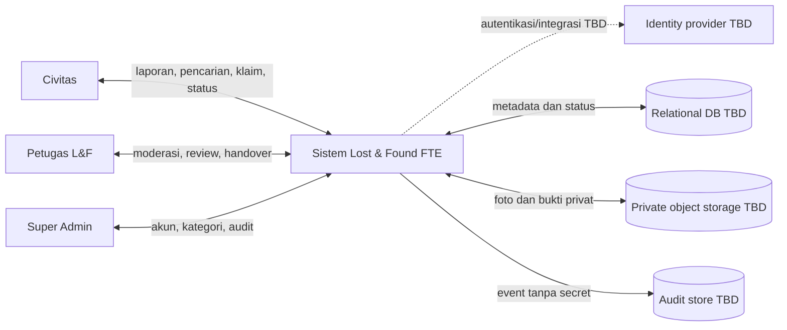
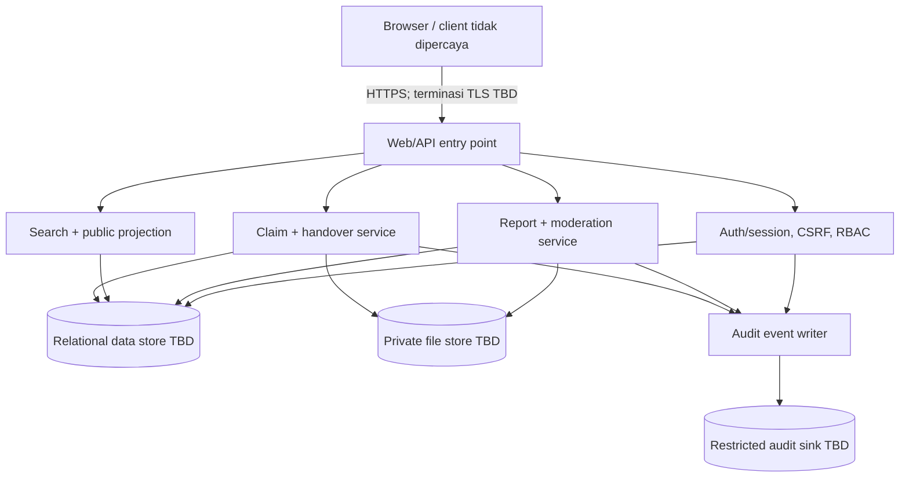
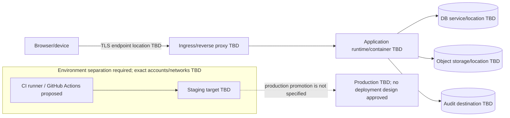

# Konteks Sistem, Logical Architecture, dan Deployment View

## Konsep Kunci
Aktor Civitas, Petugas L&F, dan Super Admin berinteraksi dengan aplikasi web. Database, object storage, identity provider, audit store dan hosting adalah pilihan logis, bukan teknologi/vendor yang telah diputuskan. Garis putus-putus menandakan integrasi bersyarat/TBD.

## Detailed Notes

### System context

### Logical architecture

### Deployment view — logical only, not approved topology

### Trust boundaries
1. Device/network → app: request, cookie, header, input, file dianggap tidak tepercaya; validasi, TLS, CSRF/session dan authorization server-side.
2. App → data services: least privilege, parameterized query, private object access; secret transport/rotation TBD.
3. Public search → browser: hanya allowlist field non-private; jangan expose proof/private attributes atau direct object path.
4. CI/staging → environment: credentials dan data terpisah dari production; DAST PRD hanya terhadap staging.

### Decision register
| ID | Belum disetujui | Dampak/owner keputusan |
| --- | --- | --- |
|  D-01  | SSO/identity eligibility, email verification, password vs institutional identity | Account lifecycle/security; owner FTE/IT |
|  D-02  | Cookie session vs JWT (PRD login-cookie dan draft pipeline/STRIDE pernah menyebut JWT) | Auth, CSRF, revocation; security/IT |
|  D-03  | Framework, DB, hosting, TLS termination, network zones, object/audit stores | Deployment, backup, availability; IT |
|  D-04  | Visibility per field vs sembunyikan satu laporan penuh saat `is_private` | Privacy/public search; product/privacy owner |
|  D-05  | Evidence/photo limits, malware scan, encryption, retention/deletion | Data governance/security; owner belum ditetapkan |
|  D-06  | State machine, competing claims, transaction/handover proof | Operasional; FTE |
|  D-07  | RPO/RTO, monitoring, on-call, recovery, capacity | Operations/IT |

## Examples
Aplikasi dapat meminta object storage privat secara logis, tetapi desain tidak menetapkan S3/MinIO atau URL publik. Sistem harus mengotorisasi setiap retrieval; signed URL/presigned approach juga belum dipilih.

## Summary
Logical architecture menguraikan komponen dan aliran tanpa mengarang platform. Deployment topology sengaja TBD sampai keputusan D-01–D-07 disetujui.

## References
PRD v1.0.0 bagian 1–10. Format diagram merujuk [Mermaid flowchart](https://mermaid.js.org/syntax/flowchart.html) dan dukungan dokumentasi [GitBook](https://gitbook.com/docs/).
