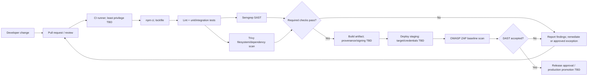

# CI/CD Security Flow — DevSecOps

## Konsep Kunci
PRD mengusulkan GitHub Actions lint/unit, Semgrep SAST, Trivy SCA, dan ZAP baseline DAST pada staging. Dokumen ini merangkai kontrol desain; pipeline tidak diklaim telah aktif. Deploy/promote production berada di luar scope sampai disetujui.

## Detailed Notes

### Pipeline mapping
| Stage | PRD intent | Security guardrail / open issue |
|---|---|---|
| Trigger | push/PR to main, staging | Branch protection, fork PR permissions and allowed workflows TBD. |
| Install/test | Node 20, npm ci, lint | PRD lists lint; test command and test coverage threshold need alignment with repo. |
| SAST | Semgrep `p/default` | Pin action by immutable commit, define severity gate/exception expiry and artifact access. |
| SCA | Trivy filesystem, HIGH/CRITICAL | Pin action, define vulnerability database refresh, ignore policy and remediation SLA. |
| DAST | ZAP baseline against staging, staging branch condition | Explicit staging URL, test account/data, safe scan scope and thresholds; do not target production by default. |
| Release | Not specified | No production deploy/promotion or approval assumed. Need signed artifact, provenance, rollback and approver policy. |

### Evidence and boundaries
Keep PR report/test/scan evidence linked to commit/run ID, subject to retention policy. CI secrets must not appear in logs or artifacts. Treat runner and third-party actions as supply-chain boundary; pin actions, restrict token permissions and review updates as proposed controls pending approval.

## Examples
Jika Trivy menemukan critical dependency, gate result behavior belum ditentukan oleh PRD; owner harus menetapkan block/exception process sebelum pipeline diberi status enforced.

## Summary
Flow menggambarkan test → SAST/SCA → staging → DAST, sesuai proposal PRD. Action pinning, thresholds, exceptions, staging credentials, approval dan production release adalah keputusan TBD.

## References
PRD v1.0.0 bagian 9. [OWASP Threat Modeling Cheat Sheet](https://cheatsheetseries.owasp.org/cheatsheets/Threat_Modeling_Cheat_Sheet.html). GitBook Markdown workflow: [Quickstart](https://gitbook.com/docs/getting-started/quickstart), [Import Markdown](https://gitbook.com/docs/getting-started/import).