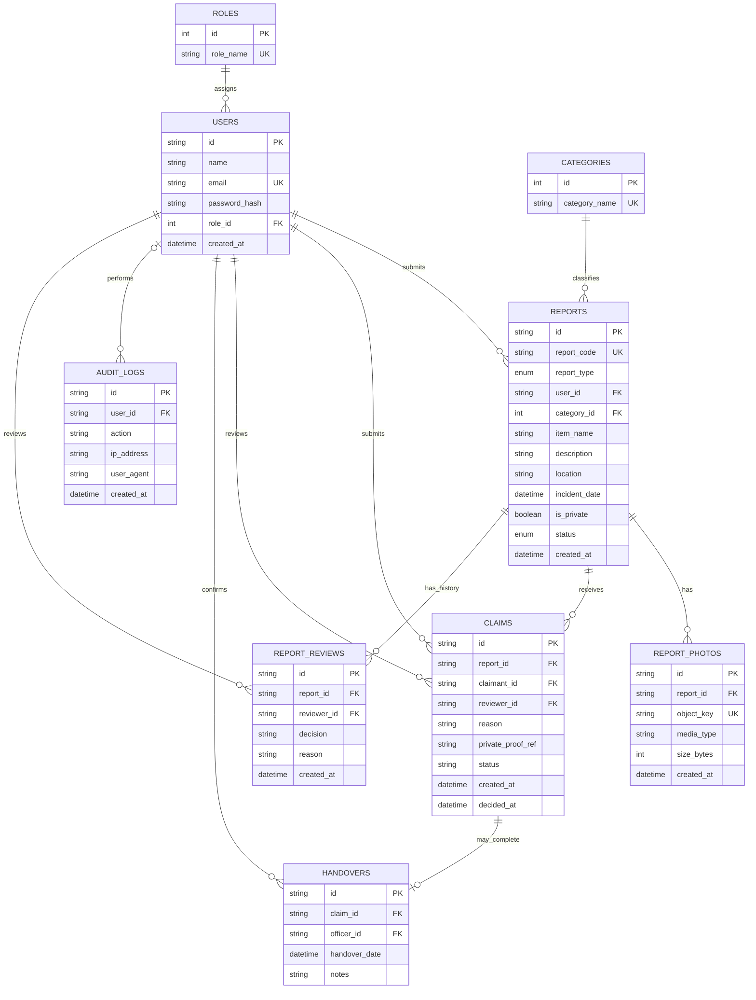

# ERD, Kamus Data, dan Constraints

## Konsep Kunci
Skema ini adalah logical proposal turunan PRD, bukan migrasi database terpilih. Mermaid ERD mendukung deklarasi entitas, atribut, PK/FK/UK dan cardinality crow-foot.[1] Syntax render harus diuji pada versi renderer yang akan dipakai.

## Detailed Notes

### ERD crow-foot

### Cardinality and interpretation
- Role 1 — 0..* users; setiap user tepat satu role pada model minimal (multi-role belum ditetapkan).
- User 1 — 0..* reports; tiap report tepat satu submitter dan category.
- Report 1 — 0..* photos/claims/review events. Photo rows terpisah menghindari repeating group; max photo count TBD.
- User dapat mengajukan banyak claims; tiap claim milik satu claimant dan satu report. Reviewer nullable sebelum review; peran petugas divalidasi melalui RBAC, bukan FK terpisah.
- Claim 1 — 0..1 handover dalam proposal ini; apakah handover historis berulang atau klaim ditolak/dibatalkan perlu keputusan.
- User 0..1 — 0..* audit events agar event sistem tanpa actor masih dapat dicatat; IP/user-agent collection/policy perlu disetujui.

### Kamus data (logis)
| Entitas.field | Tipe/aturan | Makna / asal |
|---|---|---|
| roles.id, role_name | PK integer; unique non-null string | Role Civitas/Petugas/Super Admin sesuai PRD RBAC. Seed/provisioning TBD. |
| users.id | PK UUID/string | Identifier internal. |
| users.name | string not null | Nama tampilan sesuai kebutuhan operasional (PRD menyebut nama user pada normalisasi). |
| users.email | unique not null | Email login terdaftar pada PRD; eligibility/verification TBD. |
| users.password_hash | secret verifier, nullable jika SSO? TBD | PRD: password terenkripsi/hashing Argon2id atau bcrypt; algoritma/params wajib diputuskan. Jangan menyimpan password plaintext. |
| users.role_id | FK not null | RBAC; hanya jalur provisioning terotorisasi boleh mengubah. |
| categories.id/category_name | PK; nama unique/not null | Master kategori; naming/case policy TBD. |
| reports.id/report_code | PK; kode unik | ID internal dan kode tampilan; format TBD. |
| reports.report_type | enum LOST/FOUND | Jenis laporan. |
| reports.user_id/category_id | FK not null | Pemilik/pelapor dan kategori. |
| reports.item_name/description/location/incident_date | not null kecuali nilai tidak diketahui jika kebijakan mengizinkan | Form PRD; panjang, zona waktu dan validasi lokasi TBD. |
| reports.is_private | boolean default false? **TBD** | Menandai atribut/barang sensitif; default harus disetujui dan tidak menyimpulkan visibilitas. |
| reports.status | enum | PENDING_VERIFICATION, APPROVED, NEEDS_REVISION, REJECTED, RESOLVED; transition allow-list lihat flows. |
| report_photos.object_key | unique opaque reference | Jangan jadikan path publik; format, jumlah, max size dan scan policy per keputusan. PRD menyebut jpg/jpeg/png, 2MB untuk foto laporan. |
| claims.reason | text, private | Deskripsi kepemilikan/bukti yang diberikan claimant; tidak untuk respons publik. |
| claims.private_proof_ref | nullable opaque private object reference; exact type/format TBD | Referensi ke bukti privat di D6, bukan bytes atau URL/path publik. Storage, encryption, access controls, retention, deletion, dan apakah bukti wajib atau dapat berulang semuanya TBD. |
| claims.report_id/claimant_id | FK not null | Report yang diklaim dan Civitas pengklaim; aturan satu/multi-claim TBD. |
| claims.status | string/enum TBD | Pending/approved/rejected/completed: nilai PRD campur proses review dengan complete; perlu state machine disetujui. |
| handovers.claim_id/officer_id/date | FK, timestamp | Handover fisik; satu handover per claim adalah asumsi kardinalitas. |
| report_reviews.decision/reason | enum/text | Riwayat review approve/need_revision/reject dan alasan; retention TBD. |
| audit_logs.action/ip/user_agent/created_at | event metadata | F-06: user_id/action/IP/user-agent/timestamp; secret/token dilarang; retention dan trusted proxy TBD. |

### Integrity/security constraints proposal
- Unique: email, role_name, category_name, report_code, photo object key. Case-folding email/category TBD.
- FK restrict/delete behavior ditentukan retention/legal policy; jangan cascade-delete audit evidence secara default tanpa persetujuan.
- CHECK: report_type allow-list; size_bytes > 0 dan ≤ 2,097,152 untuk report photo sesuai PRD; file media type extension dan content magic bytes harus cocok.
- Enforce state transition, owner and role checks in transactional service; FK alone does not enforce workflow.
- Claims proof/object access private by default; log access/action without content/secrets.
- Index candidate (not commitment): reports(status, category_id, incident_date), reports(report_type), claims(report_id,status); validate workload first.

## Examples
`reports.user_id` mengarah ke satu `users.id`; laporan dapat memiliki nol atau lebih foto. Klaim harus terhubung ke report dan claimant, tetapi belum ada UNIQUE(report_id) karena PRD tidak menentukan apakah klaim bersaing diperbolehkan.

## Summary
ERD menguraikan struktur normalized dan relasi; field, state, retention, privacy defaults, cascade rules, dan DB type perlu approval sebelum DDL.

## References
[1] [Mermaid ER diagram syntax](https://mermaid.js.org/syntax/entityRelationshipDiagram.html). [2] PRD v1.0.0 bagian 2–6 dan skema SQL draft bagian 7.