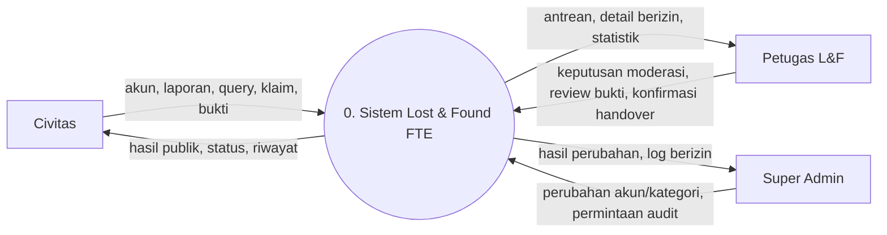
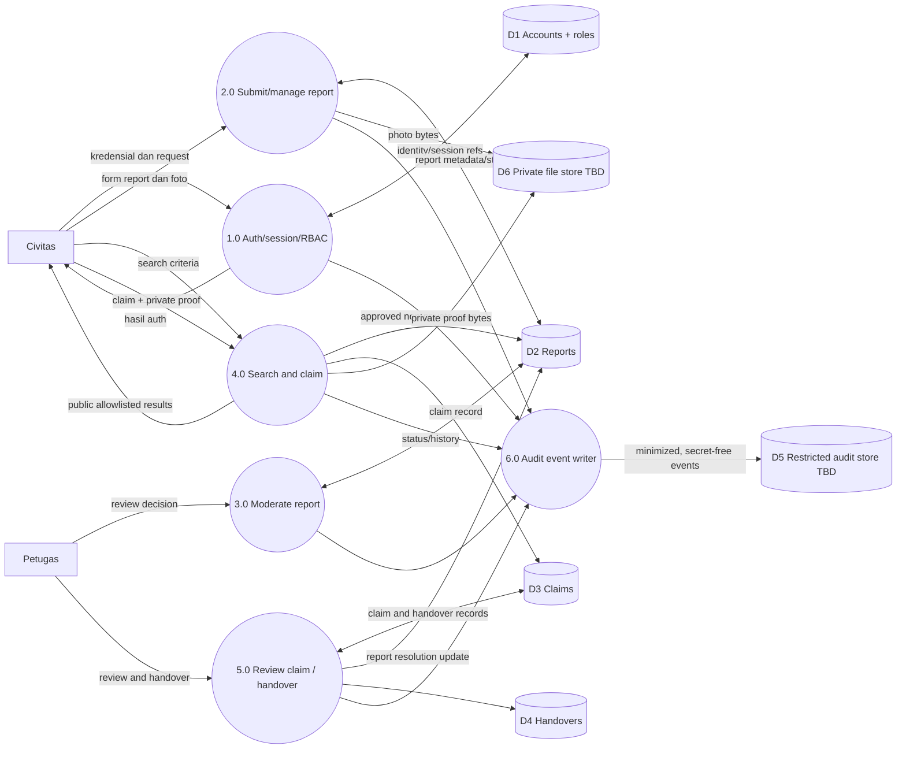
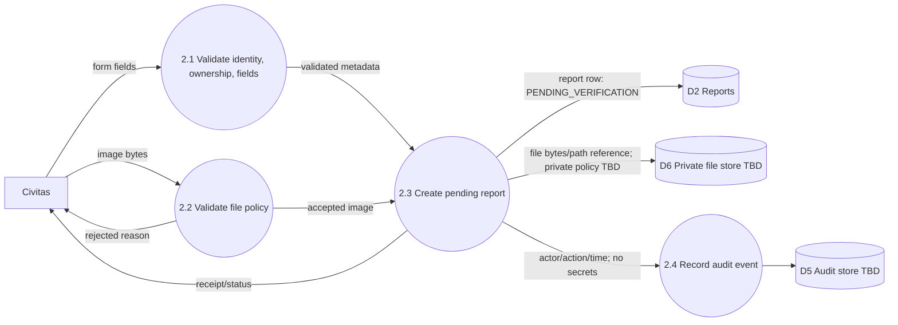
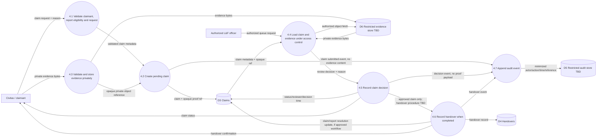

# Data Flow Diagram (DFD) L0, L1, L2

## Konsep Kunci
DFD mendeskripsikan perpindahan data, bukan sequence/timing atau deployment vendor. Diagram Mermaid menggunakan flowchart resmi.[1] Data store bertanda TBD adalah abstraksi logis.

## Detailed Notes

### DFD Level 0 — konteks

### DFD Level 1 — proses dan data store

### DFD Level 2 — proses 2.0 pelaporan

### DFD Level 2 — pengajuan, review, dan handover klaim

Privacy boundary: claim reason and evidence are private, excluded from public search/results; only authorized staff workflow accesses evidence. Exact authorization, accepted evidence types, encryption, scanning, storage architecture, access-log granularity, retention/deletion, decision states, appeal, and handover procedure remain TBD—no policy is implied here.

### Data classification / constraints across flows
- Credentials/secrets never enter audit data; F-06 names actor, action, IP, user-agent, timestamp.
- Public search result must be allowlisted and omit private proof and sensitive item attributes; meaning of report `is_private` TBD.
- All externally supplied identifiers/fields/files require validation and record-level authorization.
- D2–D6 are conceptual. Exact schema is documented in [data model](data-model.md).

## Examples
A public search request flows to 4.0 and returns an allowlisted projection, not raw report row. Claim evidence flows to private file store and authorized staff review, never to public search response.

## Summary
DFD L0 identifies parties and exchanges; L1 splits six logical processes/data stores; L2 traces report input through validation, storage and audit. Store technology remains undecided.

## References
[1] [Mermaid flowchart syntax](https://mermaid.js.org/syntax/flowchart.html). Data requirements: PRD v1.0.0 F-02–F-06.