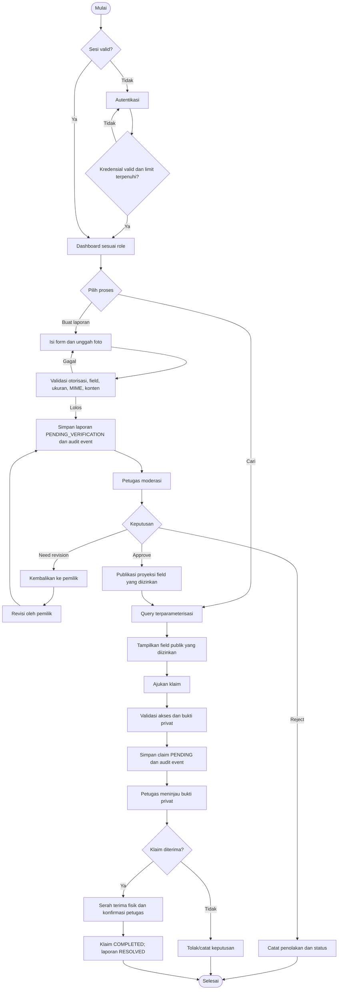

# Alur Utama Sistem

## Konsep Kunci
Alur menggabungkan pelaporan, verifikasi, pencarian, klaim, dan serah terima sebagaimana fitur PRD. Diagram flowchart menggunakan sintaks Mermaid resmi.[1]

## Detailed Notes

### Aturan/alur status yang dipastikan
- PRD menyatakan status laporan awal Pending Verification; keputusan petugas: Approve, Need Revision, Reject.
- Local prototype handbook menetapkan transisi allow-list: pending → approved/needs_revision/rejected; owner-only resubmit needs_revision → pending; approved → resolved. Diagram sengaja memakai state konsisten ini.
- PRD menyebut claim Completed dan report Resolved setelah konfirmasi serah terima. Detail transisi claim lain, competing claims, cancellation/reopen, dan atomicity adalah **TBD**.
- Tidak ada notifikasi provider, jadwal, atau email yang dijanjikan di sini; PRD menyebut notifikasi status secara konteks tetapi kanal/implementasi belum diputuskan.

## Examples
Input foto berformat tidak diizinkan atau melebihi 2 MB ditolak sebelum penyimpanan. Laporan yang di-Need Revision hanya dapat dikirim ulang oleh pemilik aslinya; setiap aksi status diverifikasi backend.

## Summary
Flow ini adalah target proses logis, bukan implementasi lengkap. Pastikan uji transisi, otorisasi, sanitasi, privasi dan pencatatan event sebelum produksi.

## References
[1] [Mermaid flowchart syntax](https://mermaid.js.org/syntax/flowchart.html). Sumber aturan status: PRD v1.0.0 bagian 3–6 dan handbook prototype `AGENTS.md`.