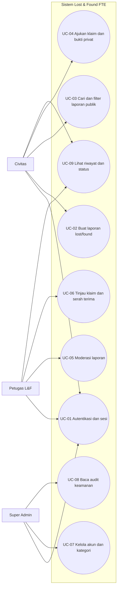

# Use Case dan Deskripsi

## Konsep Kunci
Use case memetakan sasaran aktor berdasarkan RBAC PRD. Diagram ditulis sebagai Mermaid flowchart (aktor ke sasaran use case), karena Mermaid CLI tidak mendukung sintaks usecaseDiagram khusus.[1][2][3]

## Detailed Notes

### Katalog use case
| ID | Aktor | Prasyarat | Alur/hasil utama | Alternatif/kontrol |
|---|---|---|---|---|
| UC-01 | Semua | Akun/eligibility sesuai aturan yang belum ditetapkan | Autentikasi, buat sesi, akses sesuai role | Gagal dibatasi rate limit PRD: maks 5 gagal/15 menit; session model/lockout TBD. |
| UC-02 | Civitas | Sesi valid | Kirim jenis LOST/FOUND, kategori, nama, warna/merek jika tersedia, lokasi, waktu, deskripsi, foto; status awal pending verification | Server validasi; PRD foto jpg/jpeg/png, maks 2 MB, MIME inspeksi. Privasi atribut sensitif untuk temuan. |
| UC-03 | Civitas/publik* | — | Kata kunci, kategori, lokasi, rentang tanggal; tampilkan laporan yang diizinkan | SQL parameterized/ORM dan output encoding; status/field publik perlu definisi final. *akses tanpa login tidak ditegaskan PRD. |
| UC-04 | Civitas | Laporan dapat diklaim (aturan eligibility TBD) | Ajukan alasan/ciri khusus dan bukti privat; status pending | Bukti hanya petugas berwenang; format, ukuran, jumlah, retensi TBD. |
| UC-05 | Petugas L&F | Role petugas | Review pending; approve, need revision atau reject; catat alasan/status | Backend RBAC, audit; SLA dan banding TBD. |
| UC-06 | Petugas L&F | Klaim diajukan | Verifikasi bukti, koordinasi handover fisik, konfirmasi, klaim completed dan report resolved | Konflik multi-claim, bukti, waktu/lokasi dan otorisasi konfirmasi TBD. |
| UC-07 | Super Admin | Role super admin | Kelola akun/role dan master kategori | Alur persetujuan, provisioning, pembatasan privilege TBD. |
| UC-08 | Super Admin | Hak audit | Akses audit logs | Data IP/user-agent bersifat sensitif; akses/retensi/ekspor TBD. |
| UC-09 | Civitas/Petugas | Sesi sesuai role | Lihat riwayat milik sendiri atau antrean operasional sesuai hak akses | Otorisasi per record; tidak boleh IDOR. |

### Trace ke requirement PRD
F-01 UC-01; F-02 UC-02; F-03 UC-05; F-04 UC-03; F-05 UC-04/06; F-06 UC-05/06/08. Hak akses bersumber bagian RBAC PRD.

## Examples
Petugas dapat memeriksa bukti klaim, tetapi Civitas tidak boleh mengunduh bukti klaim orang lain; otorisasi wajib diuji di endpoint, bukan hanya UI.

## Summary
Diagram mencakup tiga peran dan sasaran utama; keputusan tentang akses publik, eligibility, alur akun, klaim bersaing dan audit belum diasumsikan.

## References
[1] [Mermaid usecase syntax](https://mermaid.js.org/syntax/usecase.html). [2] [GitBook Quickstart](https://gitbook.com/docs/getting-started/quickstart). [3] PRD v1.0.0, bagian 2–6.